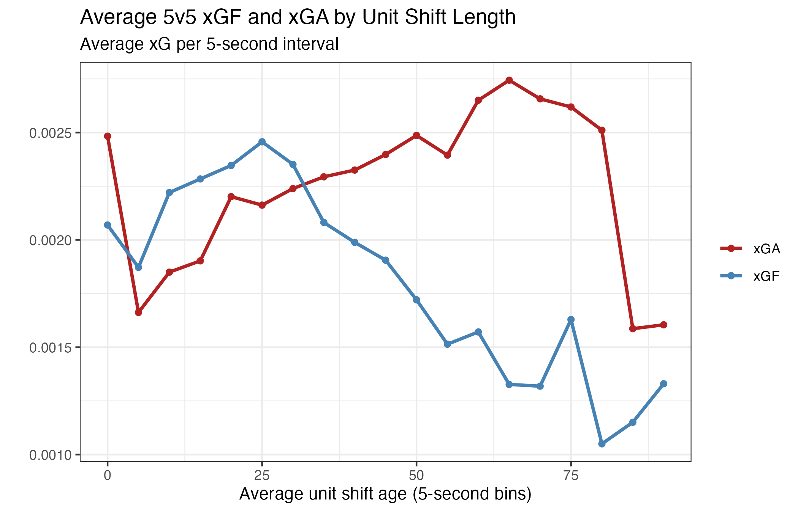
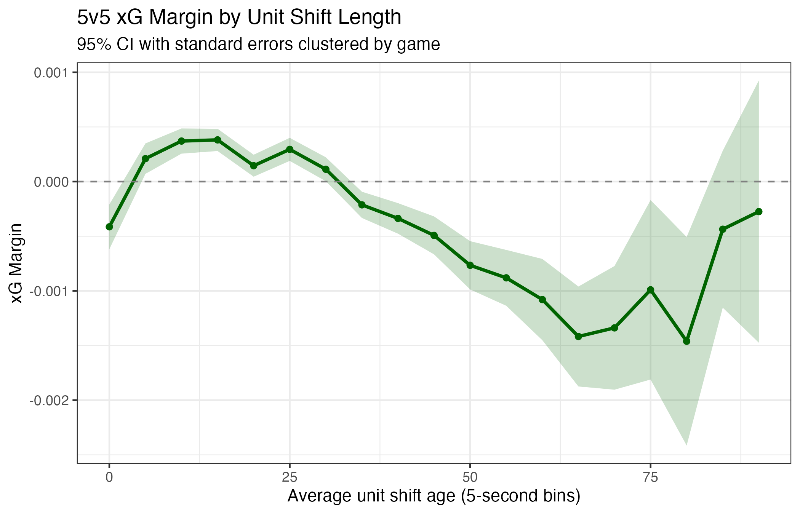
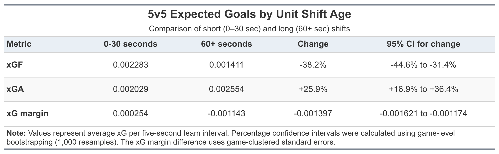
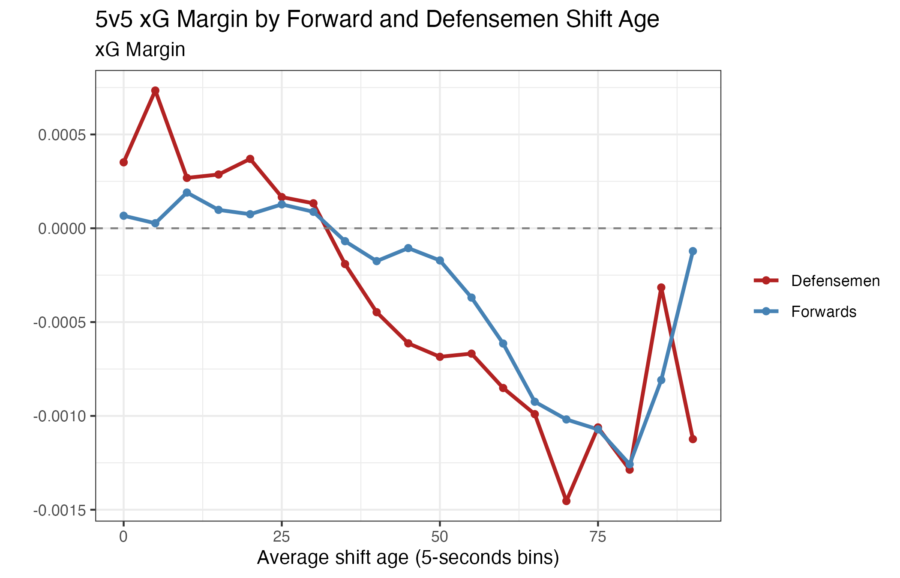
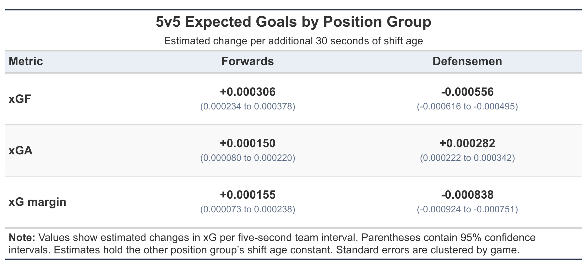

## Introduction

Hockey is a fast paced sport, and coaches are very adamant about keeping players fresh throughout a game. Players typically aim to stay on the ice for roughly 45 seconds before changing for fresh teammates [@lyonsHockey45Seconds]; each of these roughly 45 seconds stints is known as a shift in hockey. Unlike substitutions in many other sports, changes in hockey can happen as play continues. However, a team under sustained pressure in its defensive zone may be unable to safely change without giving up a dangerous scoring chance for the opponent. As a result, players can become stuck on the ice for sometimes well over a minute.

Player tracking data suggest that a player spends only around 13.82 seconds of a typical 45 second shift skating at medium or higher intensity [@lyonsHockey45Seconds]. This raises the question of whether players can remain effective for considerably longer than the typical 45 seconds coaches rave about. The ideal shift length is also not necessarily the same for every player. Former NHL coach Jim Schoenfeld noted that while most players are most efficient when working hard for 40–45 seconds, certain elite players can remain effective during longer shifts because of their unique skill set and stamina [@schoenfeld2002].

At the same time, long shifts have become increasingly visible to fans. NHL television broadcasts and some arenas display when players have been on the ice for an extended period, suggesting that the team with long shifts has a temporary disadvantage. This raises a simple question: how large is that disadvantage?

In addition to quantifying the overall relationship between long shifts and expected goals, this study examines whether that relationship changes by position. Specifically, I compared the shift lengths of forwards and defensemen separately to determine whether extended shifts at one position are more strongly associated with changes in a team's expected performance. This analysis aims to quantify not only how much of a disadvantage a long shift creates, but also whether defensemen's or forwards' shift lengths have a greater association with that disadvantage.

## Data & Methods {#sec-data-methods}

### Data Sources

Player shift, roster, and schedule information for the 2025–26 NHL season was collected in R using the `hockeyR` package [@hockeyR]. Play-by-play data were taken directly from the NHL API [@nhlAPI], and expected goals data were taken from MoneyPuck [@moneyPuck].

The final dataset combined player shift information, player position, game state, score information, and expected goals for and against on a common five second time grid. One game was excluded because of an issue with its player shift data.

### Shift Reconstruction

Raw NHL shift logs identify when individual players step on and off the ice. These events were used to reconstruct each player's continuous shifts, with each shift assigned a start and end time. Reconstructed shifts longer than 180 seconds were excluded to limit the influence of extreme or potentially inaccurate shift records, and goaltenders were removed so that the analysis included only skaters.

Each 20 minute period was divided into 240 five second intervals. The players on the ice at the start of each interval were used to represent the lineup for that interval. For each player, shift age was measured at the midpoint of the five second interval. For example, if a player had been on the ice for 20 seconds at the start of an interval, their shift age for that observation was recorded as 22.5 seconds.

### Game-State Classification

NHL play-by-play data were used to determine the number of skaters and goaltenders on the ice throughout each game. The analysis focused on primarily 5-on-5 play, excluding other even strength play such as 4-on-4 or 3-on-3. Power plays, penalty kills, empty net situations, and other non 5-on-5 states were excluded from the primary analysis.

### Expected Goals

MoneyPuck shot data were matched to the same five second intervals used for the shift data. Expected goals generated by a team during an interval were recorded as xGF, while expected goals generated by the opponent were recorded as xGA. Five second intervals with no recorded shot attempts had both an xGF and xGA of zero.

Team xG margin for each five second interval was defined as:

$$
\text{xG Margin} = \text{xGF} - \text{xGA}.
$$

Positive values indicate that the team generated more expected goals than it allowed during the interval, while negative values indicate the team allowed more expected goals than it generated.

### Team Level 5-on-5 Observations

Because the expected goal outcome is shared by all five skaters on the ice for a team during a given interval, player rows were collapsed to one team observation per five second interval. Each of the five skaters had an individual shift age calculated from the start time of their current shift, as described above. Overall unit shift age was calculated by taking the mean of the five individual shift ages within each team interval. Therefore, the unit shift age represents the average amount of time the five skaters currently on the ice had been on the ice for that shift.

For the positional analysis, the same calculation was performed separately by position. Mean forward shift age was calculated using the three forwards on the ice, while mean defensemen shift age was calculated using the two defensemen.

### Statistical Analysis

For visualization, unit shift age was grouped into five second bins, and average xGF, xGA, and xG margin were calculated within each bin. Figures were shown through 90 seconds because observations became increasingly sparse beyond this point; observations over 90 seconds represented only 0.12% of all observations.

To provide an interpretable comparison, observations were grouped into 0–30, 30–45, 45–60, and 60+ second shift-age categories. The 0–30 and 60+ groups were compared to estimate the differences in xGF, xGA, and xG margin associated with extended shifts. Observations beyond 90 seconds were kept for these grouped comparisons.

Each team-level five second interval was treated as a separate observation, meaning that the same shift contributes multiple observations as players remained on the ice. Linear regression models were used to estimate the association between shift age and xG margin. The overall 5-on-5 regression was limited to observations where unit shift ages were 90 seconds or less, while the positional regressions required both mean forward and mean defensemen shift ages to be 90 seconds or less. Because repeated observations within the same game were not independent, standard errors were clustered by game.

For the positional analysis, mean forward shift age and mean defensemen shift age were included simultaneously in the regression model. This allowed the association between one position group's shift age and team xG performance to be estimated while accounting for the shift age of the other position group. Separate models were also fit for xGF and xGA to determine whether positional differences were associated primarily with changes in offensive generation, defensive exposure, or both.

Ninety-five percent confidence intervals were calculated using game clustered standard errors for regression estimates. For percentage changes between short and long shifts, 95% confidence intervals were obtained using a game-level bootstrap in which entire games were resampled with replacement.

## 5-on-5 Shift Length Analysis

{#fig-xgf_xga_5v5}

As shown in @fig-xgf_xga_5v5, xGF generally decreases while xGA increases as average unit shift age increases. This suggests that extended shifts are associated with both reduced offensive generation and increased offensive generation for the opponent. One possible explanation is that teams experiencing sustained defensive zone pressure may be unable to safely change players, meaning longer shifts may indicate a team being trapped in the defensive zone where they are at a disadvantage.

{#fig-xg-margin-5v5}

Combining xGF and xGA into xG margin shows the same overall pattern (@fig-xg-margin-5v5). Teams generally held a positive xG margin during the earlier portions of a shift (around 5 to 30 seconds), but the margin becomes negative as average unit shift age increases. The 95% confidence intervals also become wider at the longest shift ages as the number of observations decrease rapidly.

### Magnitude of the Long-Shift Association

To quantify the relationship between shift length and team performance, expected goals were compared between observations with an average shift age of less than 30 seconds and those with an average shift age of 60 seconds or more.

{#fig-shift-comparison}

During the first 30 seconds of a shift, teams had an average 5v5 xG margin of +0.000254 per five second interval. Once average unit shift age reached 60 seconds or more, this fell to −0.001143. This represents a difference of approximately −0.001397 in xG margin per five second interval (95% CI: -0.001621 to -0.001174).

The deterioration was driven by changes in both offensive and defensive performance. Compared with the first 30 seconds, xGF was approximately **38.2% lower** during 60+ second observations (95% bootstrap CI: 31.4% to 44.6%), while xGA was approximately **25.9% higher** (95% bootstrap CI: 16.9% to 36.4%).

A linear regression was also used to examine the relationship between unit shift age and xG margin as a continuous variable. The estimated coefficient was −2.2970 × 10⁻⁵ per second, corresponding to a decrease of approximately 0.000689 in xG margin per five-second interval for every additional 30 seconds of unit shift age (95% CI: −0.000752 to −0.000627, p < 0.001). This gives additional evidence of a negative association between shift age and team performance without relying solely on the short and long shift categories.

### Comparison with the Penalty Kill

To put the magnitude of the long shift association into perspective, expected goals allowed during 5-on-5 play were compared with those during the penalty kill. Teams allowed an average of 0.002566 xGA per five-second interval at 5-on-5, compared with 0.004227 while shorthanded, representing a 64.7% increase in xGA (95% CI: 56.3% to 73.3%). By comparison, xGA was 25.9% higher during 5-on-5 observations with an average unit shift age of 60 seconds or more than during the first 30 seconds of a shift. Therefore, the increase in xGA associated with extended 5-on-5 shift is approximately **40.0% as large as the increase associated with playing on the penalty kill** (95% CI: 25.3% to 56.8%). This comparison gives a more clear understanding of the size of the disadvantage associated with long shifts.

## Positional Analysis

### Forwards vs. Defensemen

To investigate whether long shifts have different associations with team performance depending on position, the average shift ages of forwards and defensemen were examined separately. @fig-positional-graph shows the relationship between team xG margin and the average shift age of each position group. Both positions display a similar overall pattern, with xG margin generally declining as shift age increases.

{#fig-positional-graph}

However, these relationships do not account for the shift age of the other position group. Because forwards and defensemen often remain on the ice together, their shift ages are correlated (r ≈ 0.50). To account for this relationship, a multiple linear regression was fitted with both mean forward shift age and mean defensemen shift age as predictors of team xG margin. Standard errors were clustered by game.

The joint regression revealed a substantially stronger negative association between defensemen shift age and team xG margin after accounting for forward shift age. An additional 30 seconds of average defensemen shift age was associated with a **decrease** of approximately 0.00084 in xG margin per five-second interval (95% CI: −0.00092 to −0.00075). In contrast, an additional 30 seconds of forward shift age was associated with a small **increase** of approximately 0.00016 (95% CI: 0.00007 to 0.00024), holding defensemen shift age constant.

The difference between the forward and defensemen regression coefficients was statistically significant. For an additional 30 seconds of shift age, the estimated difference between their associations with xG margin was approximately 0.00099 (95% CI: 0.00084 to 0.00115, p < 0.001). This suggests that defensemen shift age is a substantially stronger negative indicator of team xG performance than forward shift age when both are considered simultaneously.

The positive forward coefficient may seem surprising at first, given that the unadjusted forward curve shows declining xG margin as shift age increases (@fig-positional-graph). However, forward and defensemen shift ages are moderately correlated, meaning that longer forward shifts often happen along with longer defensemen shifts. By including both positions in the regression, the model estimates the association with forward shift age while holding defensemen shift age constant. While we cannot determine exactly why this association is positive, one possible explanation is that situations where forwards remain on the ice longer than defensemen may indicate sustained offensive zone possession. During offensive zone possession, defensemen positioned near the blue line may be able to change while the forwards continue cycling the puck and generating scoring chances.

### Offensive and Defensive Associations

To better understand the differences between positions, separate regression models were fitted for xGF and xGA. The estimated associations for each position group are summarized in @fig-position-comparison.

{#fig-position-comparison}

An additional 30 seconds of average defensemen shift age was associated with approximately 0.00056 lower xGF and 0.00028 higher xGA per five-second interval, resulting in a net decline in xG margin of approximately 0.00084.

In contrast, an additional 30 seconds of average forward shift age was associated with approximately 0.00031 higher xGF and 0.00015 higher xGA, producing a small positive net association with xG margin. Although longer forward shifts were associated with greater defensive exposure, the estimated increase in offensive generation was larger, resulting in a slightly positive net association after accounting for defensemen shift age.

One possible explanation for these positional differences is that forwards and defensemen accumulate long shifts under different game conditions. For example, when the defensemen have been on the ice for 40 seconds while the forwards have recently changed, it may indicate that the team has been under sustained defensive-zone pressure. Forwards may have been able to change while the defensemen remained unable to safely leave the ice. Conversely, forwards may sometimes accumulate longer shifts during sustained offensive zone possession, when a team maintains pressure on its opponent. However, the observational analysis cannot determine whether these relationships are primarily due to fatigue, game context, or a combination of both.

## Limitations

One of the primary limitations of this study is simply that it is observational. Although longer shifts were strongly associated with worse expected goal performance, this does not necessarily mean that fatigue caused the decline. Teams under sustained defensive zone pressure may be unable to safely change players, causing longer shifts to occur during unfavorable game situations. Therefore, long shifts may act as both an indicator and result of poor game situations. The analysis cannot determine how much of the observed relationship is attributable to fatigue rather than game context.

Another limitation comes from the use of five second intervals to reconstruct player shifts and measure expected goal performance. Players on the ice at the beginning of an interval were used to represent the lineup for the entire five seconds. As a result, substitutions occurring within an interval could cause expected goal events to be associated with players who were no longer on the ice. Additionally, one shift contributed multiple observations as players remained on the ice, meaning that observations within a game were not fully independent. To account for this dependence, regression standard errors and confidence intervals were clustered by game. However, longer shifts still contributed more observations than shorter shifts, so the results represent performance across five second intervals rather than average outcomes per completed shift.

The study was also limited to data from the 2025–26 NHL season, with one game being excluded due to an issue with its player shift data. Reconstructed shifts longer than 180 seconds were removed to limit potentially inaccurate records. Furthermore, the analysis measured performance at the team level rather than for individual players. With only one season of data, there was insufficient information to reliably compare how individual players performed during extended shifts. Future research using multiple seasons could investigate whether certain players, such as elite forwards or defensemen, maintain their effectiveness longer than others.

Finally, the linear regression models assumed a constant relationship between shift age and expected goal performance across the modeled range. However, the descriptive figures (@fig-xgf_xga_5v5, @fig-xg-margin-5v5) suggest that the relationship may not be perfectly linear, with performance changing more noticeably at certain shift ages. Future analyses could explore nonlinear models to determine whether there are particular points during a shift when performance begins to deteriorate more rapidly.

## Conclusion and Practical Implications

Due to the limitations discussed, this analysis cannot establish a cause and effect relationship between longer shifts and declining team performance. It is difficult to determine whether the decrease in performance is primarily caused by player fatigue, unfavorable game situations, or a combination of both. However, the results demonstrate a substantial association between long shifts and worse expected goal performance.

During 5-on-5 play, teams with an average unit shift age of 60 seconds or more generated approximately 38.2% less xGF and allowed 25.9% more xGA than during the first 30 seconds of a shift. To put this into perspective, going on the penalty kill was associated with a 64.7% increase in xGA compared with regular 5-on-5 play. Therefore, the percentage increase in xGA associated with a long shift was approximately 40% as large as the increase associated with playing shorthanded. This comparison helps put the magnitude of the disadvantage associated with extended shifts into perspective.

The positional analysis further suggests that defensemen shift age may be a more useful indicator of unfavorable on ice conditions than forward shift age. After accounting for forward shift age, longer defensemen shifts were associated with a substantially greater decline in xG margin than longer forward shifts. This may reflect the difficulty defensemen face in changing during sustained defensive zone pressure, although the analysis cannot determine whether this explanation is responsible for the observed relationship.

From a practical standpoint, these findings support the value of highlighting longer shifts during NHL broadcasts and on arena displays, particularly when defensemen have been on the ice for an extended period. While this analysis does not establish that fatigue directly causes poor performance, shift age can still serve as a useful indicator of unfavorable on ice conditions. For coaches, monitoring shift age alongside game context may help identify situations in which a line change is becoming increasingly important. As for viewers at home, the next time an announcer mentions that the defensemen have been stuck on the ice for over a minute, it may be worth paying a little closer attention. The extended shift could be signaling a measurable advantage in expected goal performance for the opposing team.

Ultimately, the findings suggest that the attention given to long shifts during NHL broadcasts is justified. Extended shifts are not simply an interesting statistic for viewers; they are associated with measurable differences in expected goal performance, especially when defensemen remain on the ice for prolonged periods.

## Acknowledgements {.unnumbered}

This manuscript was prepared using the
[JSDSS manuscript template](https://github.com/jsds-sports/jsdss-manuscript-template).

## References {.unnumbered}
:::{#refs}

:::